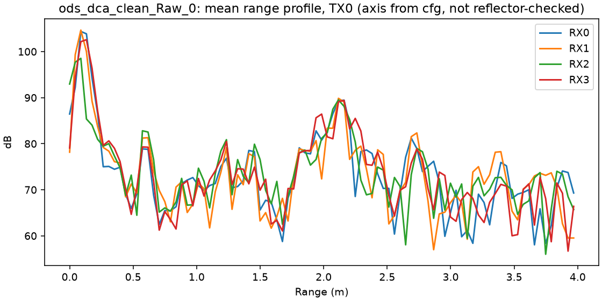

# IWR6843ISK-ODS + DCA1000 raw-data toolkit

Offline Python tools for raw ADC captures from a TI **IWR6843ISK-ODS** 60 GHz FMCW radar recorded with a **DCA1000EVM**.

| Stage | What it does |
|---|---|
| Parse | `.bin` → ADC cube |
| Frame | ADC cube → frame / loop / TX tensor |
| Range | range profiles |
| Range-Doppler | RD maps in physical units |
| Capture check | consistency checks that settle the binary layout from the data itself |

Written for a head-mounted, near-field sensing project during a research-assistant position at the School of Computing, Macquarie University (Nov 2025 – May 2026).

## Status

| Part | State |
|---|---|
| Binary layout (complex, RX-major, Q-first, 2048 int16 per chirp) | **confirmed** on two captures; see [docs/DATA_FORMAT.md](docs/DATA_FORMAT.md) |
| Frame structure (96 chirps = 32 loops × 3 TX, TX order 0-2-1) | confirmed from cfg; frame length inferred from the data |
| Range FFT, framed range-Doppler map, metre / m/s axes | working; axes are **computed from cfg, not yet reflector-checked** |
| Synthetic end-to-end tests | 9 tests passing (`pytest`) |
| Angle processing, point cloud, detection, learning | not started (out of scope for this stage) |

Milestones and what is left: [docs/PIPELINE.md](docs/PIPELINE.md).
Profile parameters and derived resolutions: [docs/RADAR_CONFIG.md](docs/RADAR_CONFIG.md).



## Setup

```bash
python -m pip install -r requirements.txt     # Python 3.11+, numpy, matplotlib, pytest
python -m pytest -q                             # synthetic checks
```

Run the scripts from the repository root. Raw `.bin` files are not in git; put them in `data/raw/`.

## Usage

```bash
# 1. Read a TI CLI profile and print the derived resolutions (optional: write a JSON sidecar)
python scripts/ti_cfg.py configs/ti/iwr6843ods_capture_32loops_reconstructed.cfg

# 2. Check a capture: layout scores, zero chirps, frame evidence, range/RD figures + report.md
python scripts/analyze_capture.py data/raw/capture.bin --config configs/ods_iq_frames.json --out outputs/analysis/run01

# 3. Parse only
python scripts/parse_bin.py data/raw/capture.bin --config configs/ods_iq_frames.json

# 4. Range-Doppler map of one frame / TX / RX (Doppler over the 32 loops of that TX)
python scripts/build_rd_map.py data/raw/capture.bin --config configs/ods_iq_frames.json \
       --framed --drop-partial-frames --frame 0 --tx-canonical 0 --rx 0 --max-range 4 \
       --output outputs/figures/rd.png

# 5. Single-chirp range FFT diagnostic
python scripts/validate_range_fft.py data/raw/capture.bin --config configs/ods_iq_frames.json --chirp 0 --rx 0
```

Debug helpers, not part of the formal path:
- `scripts/debug_parse_pipeline.py --try-layouts`
- `scripts/debug_parse_compare.py`
- `test_trim_and_plot.py` (the first exploratory script, March 2026)

## Layout

```
configs/
  ods_iq_frames.json          parser sidecar for the 32-loop captures (use this)
  from_raw_capture.json       sidecar for the proposed 64-loop profile
  example_radar.json          template
  ti/                         TI CLI profiles + DCA1000 cf.json
scripts/
  config_loader.py            RadarConfig (+ derived range/velocity resolution)
  ti_cfg.py                   TI .cfg -> RadarConfig
  parse_bin.py                int16 stream -> (chirp, sample, rx); zero-chirp detection
  iq_frame_tensor.py          -> (frame, loop, tx, rx, sample); TX reorder; zero-chirp fill
  build_rd_map.py             range-Doppler maps
  validate_range_fft.py       range FFT diagnostic
  analyze_capture.py          data-driven layout / frame checks + figures + report
tests/                        synthetic TDM-MIMO round trip and RD peak tests
docs/                         data format, pipeline status, radar configuration, figures
data/raw|cfg|metadata/        local captures (git-ignored)
```

## `RadarConfig` fields (JSON)

| Field | Meaning |
|---|---|
| `num_adc_samples`, `num_rx`, `num_tx`, `num_loops`, `chirps_per_frame` | capture geometry |
| `is_complex` | complex (IQ) vs. real ADC output |
| `iq_interleave` | `rx_major` (TI chanInterleave = 1) or `sample_rx` (= 0) |
| `iq_order` | `QI` (TI sampleSwap = 1) or `IQ` (= 0) |
| `tx_stream_order` | TX fired in each chirp slot of a loop, e.g. `[0, 2, 1]` |
| `sample_rate_hz`, `freq_slope_hz_per_s`, `start_freq_hz`, `chirp_cycle_s`, `frame_period_s` | used for metre / m/s axes |
| `config_verified` | set manually only after a reflector test |

## History

See [CHANGELOG.md](CHANGELOG.md).
- March–April 2026: written during the RA position.
- November 2026: reviewed and corrected at hand-over.
