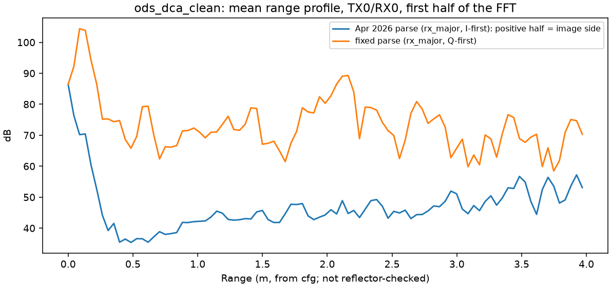

# Raw data format: IWR6843ISK-ODS + DCA1000

What the `.bin` files from this setup contain, how each point was established, and what is still open.
Status labels: **confirmed** = checked against the data and consistent with the TI config;
**inferred** = consistent with the evidence but not tested directly; **open** = not yet known.

## Summary

| Item | Value | Status | Evidence |
|---|---|---|---|
| Container | flat little-endian `int16` stream, no headers (DCA1000 `dataLoggingMode: raw`) | confirmed | file sizes are whole chirps plus a short tail (184 / 608 words) |
| Sample type | complex (I and Q), 16-bit | confirmed | `adcCfg 2 1`; near one-sided spectra (below) |
| Words per complex sample | **Q first, then I** | confirmed | `adcbufCfg -1 0 1 1 1` → sampleSwap = 1; I-first parsing puts 99.7 % of the energy in the negative half |
| Order inside a chirp | **RX-major**: RX0's 256 samples, then RX1, RX2, RX3 | confirmed | `adcbufCfg` chanInterleave = 1; RX-major gives a ~400:1 one-sided spectrum, sample-interleaved only ~5:1 |
| Samples per chirp | 256 per RX → 2048 `int16` per chirp | confirmed | profileCfg; spectra consistent across all 4 RX |
| TX order per loop | TX0, TX2, TX1 (chirpCfg TX masks 1, 4, 2) | confirmed from cfg | `tx_stream_order: [0, 2, 1]` |
| Chirps per frame | 96 = 32 loops × 3 TX | inferred (strong) | all-zero chirps recur every 96 chirps; least coherent same-TX transitions recur every 32 loops; ~4 880 chirps in the 5 s capture window ≈ 50 frames × 96 at 10 Hz |
| Frame period | 100 ms (10 Hz) | inferred | capture length vs. `durationToCapture_ms: 5000`; matches the pre-April profile notes |
| Frame start inside the file | chirp 0 assumed | **open** | the per-frame disturbance sits at chirps 4–5, so the boundary could also be there; matters for TX labelling in angle processing |
| Doppler sign (approaching = + or −) | — | **open** | neither capture has a clearly moving target |
| Range axis in metres | 4.41 cm / bin from cfg | **open** | not yet checked with a reflector at a known distance |

## Layout scores on the two captures

From `scripts/analyze_capture.py` (first 960 chirps).

`E(+f)/E(-f)` is the energy ratio between the positive and negative halves of the range spectrum. Complex-1x sampling rejects the image, so the right layout should give a strongly one-sided spectrum.

| Layout (interleave / word order) | `ods_dca_clean` E(+f)/E(-f) | `egowave_trial_01` E(+f)/E(-f) |
|---|---|---|
| **rx_major / QI** (adopted) | **387** | **431** |
| rx_major / IQ (April 2026 default) | 0.0026 (mirror of the above) | 0.0023 |
| sample_rx / QI | 5.3 | 5.2 |
| sample_rx / IQ | 0.19 | 0.19 |

Effect on the plots: `figures/iq_order_before_after.png`.

## All-zero chirps

Both captures contain chirps whose 2048 words are all exactly zero:

| Capture | Count | Positions |
|---|---|---|
| `ods_dca_clean` | 25 | chirps 4 and sometimes 5 of each 96-chirp frame |
| `egowave_trial_01` | 11 | same positions |

The most likely cause is LVDS/Ethernet packets that were lost and zero-filled; this has not been confirmed.

They sit at loop 1, TX slots 1 and 2. Handling:
- `parse_bin.parse_adc_cube` reports them in `meta`.
- `iq_frame_tensor.fill_zero_chirps` replaces them with the mean of the neighbouring loops before the Doppler FFT. This is a cosmetic fill, not a recovery of the data.

Recommended for new captures:
- record the DCA1000 log/CSV next to each `.bin`;
- try a larger `packetDelay_us` to see whether the gaps disappear.

## What the two captures show

- **`ods_dca_clean_Raw_0.bin`** (2026-03-28): 30 full frames, mostly static.
  - The TX→RX coupling / near-range peak is at about 0.1 m.
  - There is a reflector at about 2.1 m.
  - All four RX profiles agree.
- **`egowave_trial_01_Raw_0.bin`** (2026-04-01): 50 full frames.
  - Same static structure.
  - A small, fluctuating return near 0.65 m.
  - There is no clear moving target, and the RD energy stays within about ±1 Doppler bin (0.8 m/s per bin).

Both are format-validation recordings. They are not labelled experiment data.

## Open items (in order)

1. **Reflector test**: a corner reflector at 0.5, 1.0 and 2.0 m, to check the metre axis (milestone M2.3 in `PIPELINE.md`).
2. **Moving target of known direction**: e.g. walking straight towards the radar, to fix the Doppler sign and check the velocity axis.
3. **Frame boundary**: start the DCA1000 recording before `sensorStart` and check whether the zero chirps move. Alternatively, identify the TX slots from the virtual-array phase pattern of a boresight reflector.
4. Cause of the zero chirps (packet loss vs. configuration).
